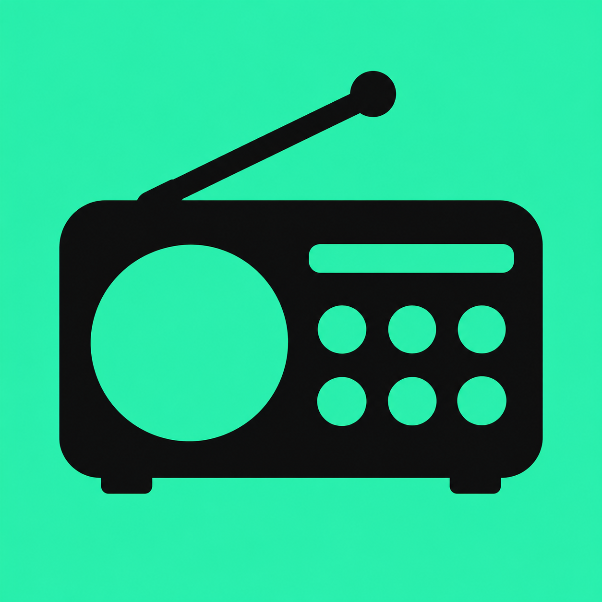
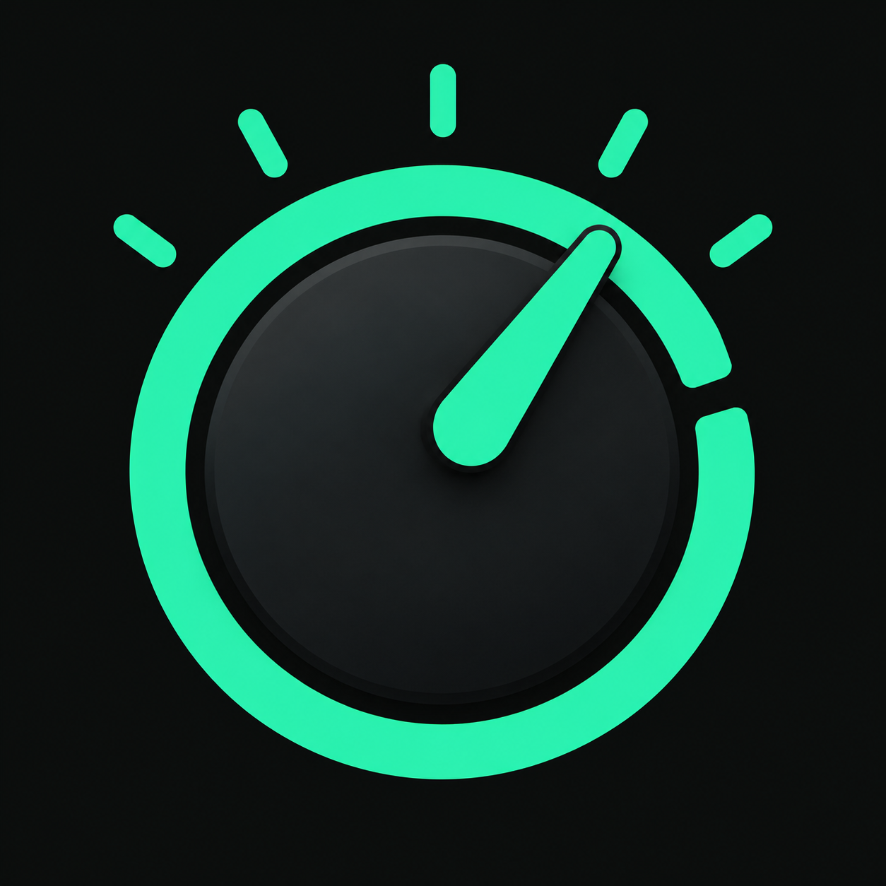

# DIAL — two app icon concepts

## B — six-key radio: recommended first test

[Download the editable vector SVG](b-six-key-radio.svg) — 1024 × 1024 viewBox, flat vector shapes, no embedded raster image.

A black radio receiver on a bright mint background. The receiver silhouette communicates radio, and the six buttons connect to DIAL's six preset stations. Hypothesis: clearer category recognition and a more visible color field can help attract relevant visitors. Risk: a familiar radio silhouette may be less distinctive among radio utilities.

## A — tuning dial: brand-oriented alternative

A mint tuning instrument on a dark background. Connects to the name DIAL and the app's tuning-scale interface. Hypothesis: simple geometry and a strong brand connection can help recognition. Risk: the needle and circle may suggest a speedometer or timer rather than radio.

## Scope of competitor research

Suggested benchmark set for international iOS internet radio: TuneIn Radio, myTuner Radio, Simple Radio, radio.net and Radioplayer. This is a shortlist, not a current ranking or an exhaustive market survey. App Store search requests were blocked with HTTP 403 in this environment, so current competitor icon artwork, regional positions and conversion performance were not verified. No competitor-specific performance claims are made.

The design comparison uses general category choices: a readable app-category symbol versus an abstract brand symbol; bright versus dark background; minimal detail versus decorative complexity. Both concepts use the app's mint accent and omit small text.

## How to evaluate

Compare A and B with the same screenshots, listing copy and price in the same locale. Evaluate install conversion using the experiment's defined denominator and confidence reporting; also inspect acquisition source and visitor quality. An attractive icon alone does not establish conversion lift. If using App Store Connect Product Page Optimization to test app icons, prepare the alternate icons in the app build and follow Apple's review requirements.

These are visual concepts, not verified high-converting winners. PNGs retain their generated pixel dimensions; final app-icon exports and the app's asset catalog still need preparation.

[Download both PNGs and notes](dial-icon-concepts.zip) · [Generation prompts](prompts.md)
