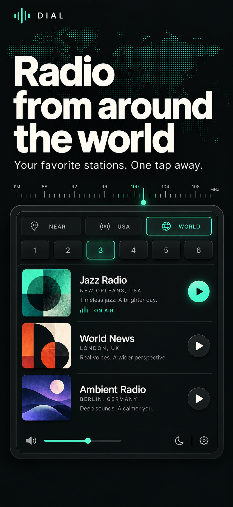
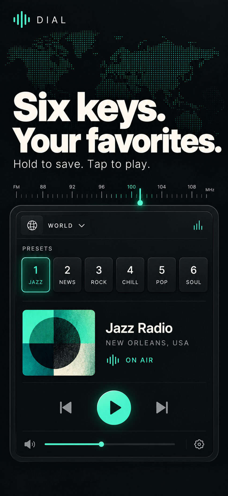
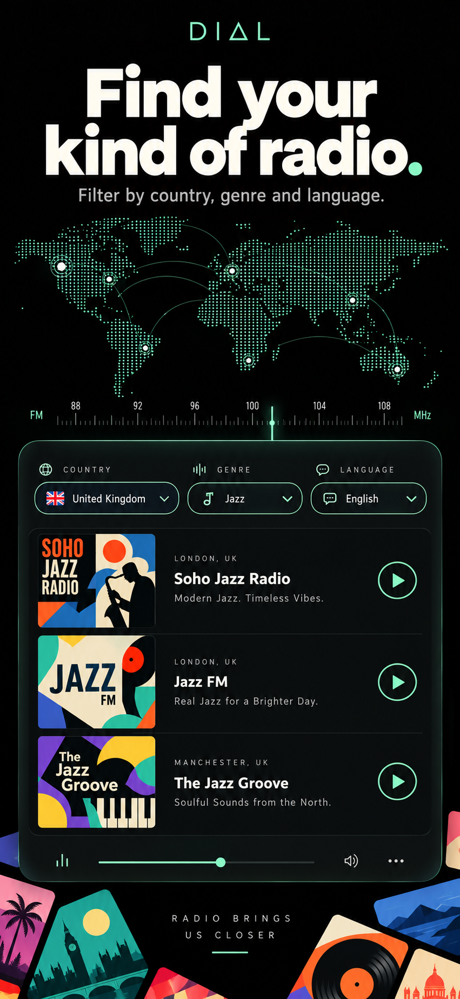
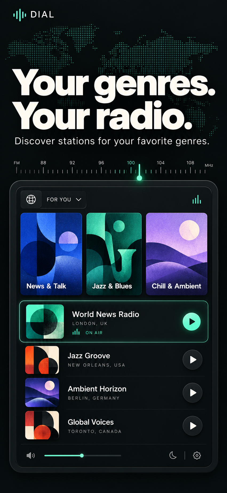
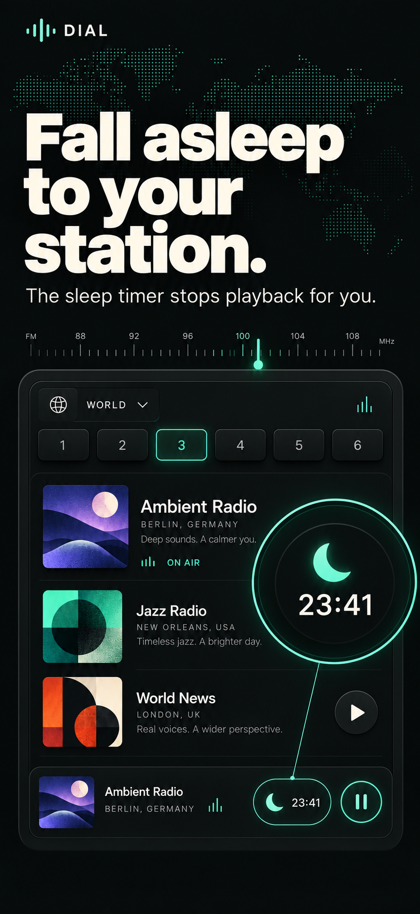

# DIAL — English screenshot concepts

Five coordinated promotional concepts in a dark and mint palette.

[Download all five PNGs as a ZIP](dial-en-screenshots.zip)

## Radio from around the world

[Open PNG](01-world.png) · 851 × 1848 px

## Six keys. Your favorites.

[Open PNG](02-presets.png) · 851 × 1848 px

## Find your kind of radio.

[Open PNG](03-filters.png) · 851 × 1849 px

## Your genres. Your radio.

[Open PNG](04-genres.png) · 851 × 1848 px

## Fall asleep to your station.

[Open PNG](05-sleep-timer.png) · 851 × 1848 px

## Production notes

These images are promotional design concepts with illustrative station artwork and sample interface details. They are not captures of a running iOS build. Before App Store submission, use the actual iOS interface and export at an accepted screenshot resolution. The files here retain their original generated pixel dimensions.

[Generation prompts](prompts.md)
